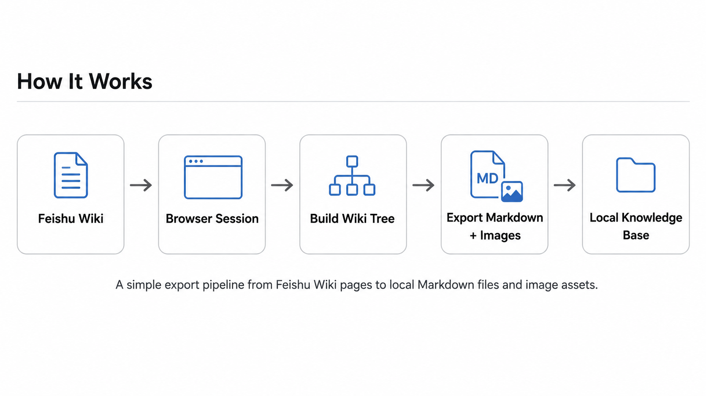
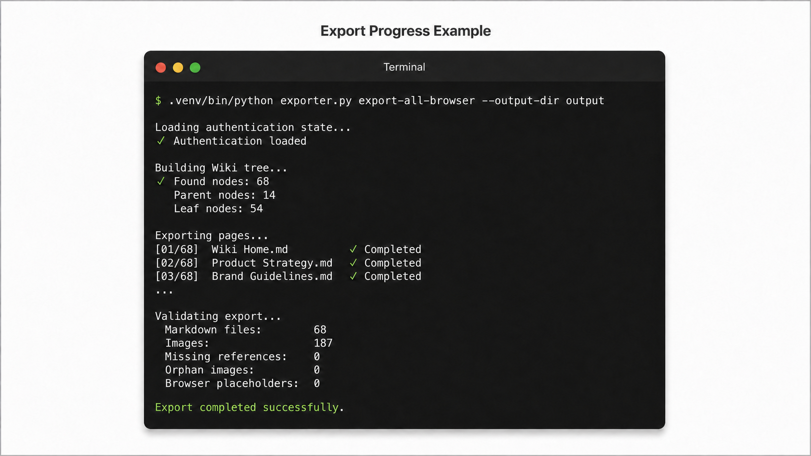
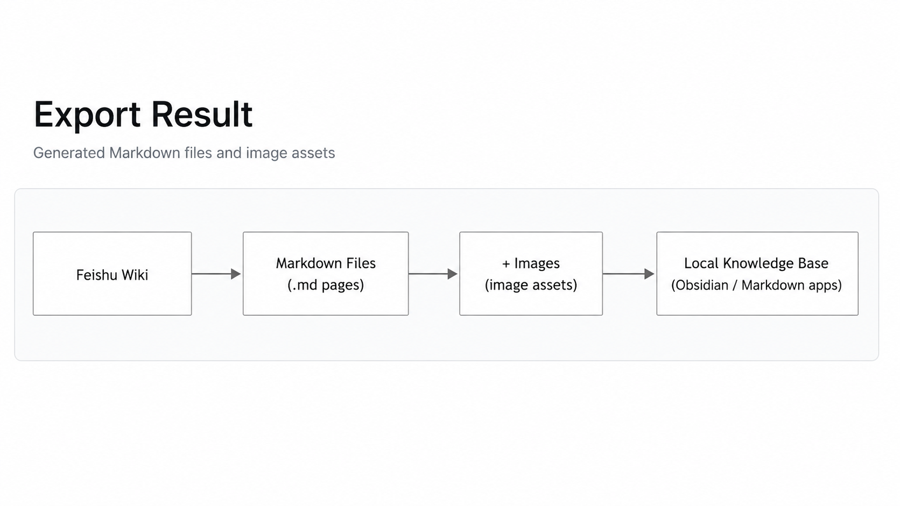

# Feishu Wiki Course Exporter

[English](README.md) | [简体中文](README.zh-CN.md)

A personal-use command-line tool for exporting Feishu Wiki content that the
currently signed-in account is authorized to access. It rebuilds the complete
Wiki node tree and exports every discovered node as Markdown with local image
resources.

This project is not affiliated with Feishu or ByteDance.

## Overview

The exporter uses a local browser login state, captures the Wiki directory
requests needed to rebuild the tree, then delegates page conversion to the
patched `feishu-docx` bundled with this repository.

Stable workflow:

```text
login -> capture-network -> build-tree -> export-all-browser
```

## How It Works

Feishu Wiki Exporter converts Feishu Wiki pages into local Markdown files while
preserving embedded images.



The exporter uses the current authenticated browser session to discover
accessible Wiki nodes and saves pages with their images as reusable local
Markdown knowledge files.

## Features

- Exports every discovered Wiki node, including parent and leaf nodes.
- Preserves the Wiki hierarchy in the output directory.
- Produces Markdown and local image resources.
- Verifies generated Markdown, local image references, and the absence of
  `browser-asset://` placeholders before counting a node as successful.
- Continues after individual page failures and records them in a local JSONL
  failure log.

## Safety, Privacy, and Authorization

- Export only content that you are authorized to access and save.
- The project does not bypass Feishu permissions and does not use Feishu Open
  Platform credentials.
- `data/storage_state.json` contains reusable browser login state. Keep it
  private and never share it.
- Do not commit `data/` or `output/`. They can contain page URLs, tokens,
  exported content, images, and failure logs.

See [SECURITY.md](SECURITY.md) for reporting and sensitive-data guidance.

## Requirements

- Python 3.11 or later.
- macOS or Linux. The documented commands use the project-local
  `.venv/bin/` layout; Windows has not been documented or validated.
- A Feishu account with access to the target Wiki.

## Installation

```bash
python3 -m venv .venv
.venv/bin/python -m pip install -r requirements.txt
.venv/bin/playwright install chromium
```

`requirements.txt` installs the repository's patched wheel:
`vendor/feishu_docx-0.2.7-1patched-py3-none-any.whl`. The exporter always
uses `.venv/bin/feishu-docx`; it does not rely on shell `PATH` order. If that
file is missing or is not executable, the exporter exits with an explicit
error.

Verify the project-local CLI after installation:

```bash
.venv/bin/feishu-docx --version
```

## First-Time Login

Use a Wiki homepage that your account can access:

```bash
.venv/bin/python exporter.py login "https://your-domain.feishu.cn/wiki/<wiki_token>"
```

Finish the login in the browser window, then return to the terminal. The
browser state is saved to `data/storage_state.json`.

## Export a Wiki

Run the full workflow in order:

```bash
.venv/bin/python exporter.py login "https://your-domain.feishu.cn/wiki/<wiki_token>"
.venv/bin/python exporter.py capture-network "https://your-domain.feishu.cn/wiki/<wiki_token>"
.venv/bin/python exporter.py build-tree
.venv/bin/python exporter.py export-all-browser --output-dir output
```

The exporter provides visible progress during authentication, wiki tree
building, page export, and output validation.



To tell whether the export is running normally:

- `[n/total]` shows current export progress.
- `Completed` means the page has been exported successfully.
- Validation results such as missing references and browser placeholders should
  be `0`.
- The export is successful when the command finishes normally with exit code `0`.

`capture-network` records response metadata locally. `build-tree` uses that
metadata and the saved login state to reconstruct the complete Wiki tree.
`export-all-browser` exports every node in that tree.

## Export Output

The exporter generates Markdown pages and local image assets that can be reused
in Markdown-based knowledge systems.



## Output and Success Criteria

The output preserves page hierarchy. A page Markdown file and its local image
directory are written together, for example:

```text
output/
├── Page.md
└── Page/
    ├── image.png
    └── image-1.png
```

A node is counted as exported only when its Markdown file exists, is non-empty,
does not contain `browser-asset://`, and every local Markdown image reference
exists on disk.

The exporter retries one failed page once, continues with remaining nodes, and
writes final failures to:

```text
output/export_failures_browser.jsonl
```

The command exits with status `0` only when every node passes export and
post-export validation. Any page failure produces a non-zero final exit status.

## Limitations

- Export scope is limited to nodes discoverable by the signed-in account.
- Browser login state can expire and page-level permissions or Feishu page
  changes can cause individual exports to fail.
- The project is a local CLI only. It provides no GUI, cloud service,
  database, synchronization, or permission-bypass capability.
- Existing output should be treated as sensitive local data. Use a fresh output
  directory when you need to keep runs separate.

## Documentation

- [Chinese README](README.zh-CN.md)
- [Troubleshooting](TROUBLESHOOTING.md)
- [Security Policy](SECURITY.md)
- [Changelog](CHANGELOG.md)
- [Historical audit notes](docs/audits/成功版本能力差异审计报告.md)

## Attribution

This project is based on [feishu-docx](https://github.com/leemysw/feishu-docx)
by [leemysw](https://github.com/leemysw). The upstream project provides the
underlying Feishu/Lark document conversion, browser export, local asset
handling, and `feishu-docx` package and CLI capabilities.

This repository adds a focused Wiki full-export workflow around that foundation,
including browser-session login, network capture, recursive Wiki tree
reconstruction, parent-and-leaf node export, deterministic use of a patched
local CLI, post-export validation, failure logging, and batch exit-code handling.

## Validation Snapshot

The current acceptance snapshot recorded:

- 68 Wiki nodes;
- 68 successful exports;
- 0 failed exports;
- 187 image resources;
- 0 missing Markdown image references.

This is an acceptance-run snapshot, not a guarantee for every Feishu tenant,
account, or future page structure.

## Legal and Responsible Use

- Export only Feishu content that you are authorized to access and permitted to save.
- You are responsible for copyright, privacy, confidentiality, data-protection,
  and commercial-use compliance for the content you export.
- Do not use this project to bypass access controls, redistribute protected
  content, or expose another person's private data.
- The developers and maintainers are not responsible for misuse of the tool or
  for content handled by users.

## License

Distributed under the [MIT License](LICENSE).
